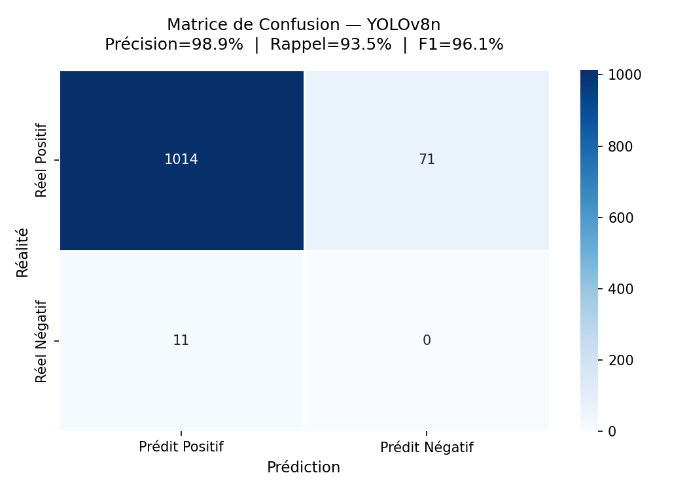
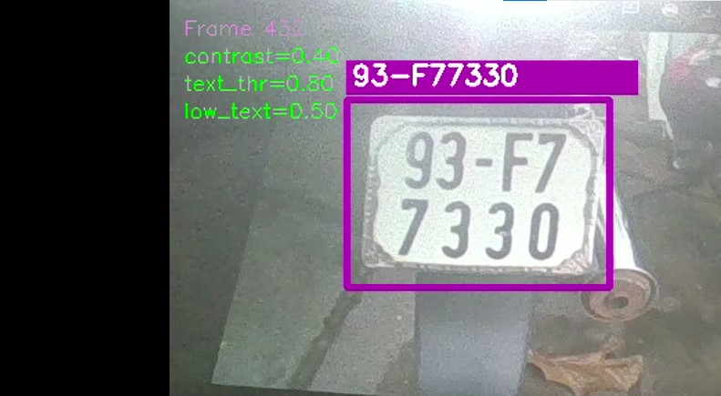
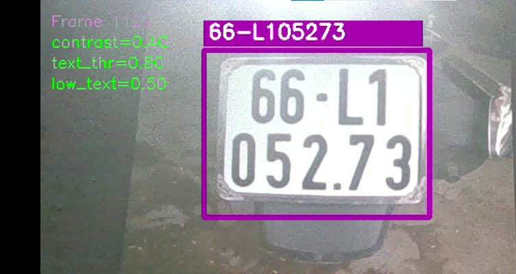

# 🚘 Automatic License Plate Recognition (ALPR)

### Real-Time License Plate Detection and Recognition Using YOLOv8, EasyOCR and OpenCV

**Author:** Leroy Makita Loubaki  
**Project Type:** Personal Computer Vision Project  
**Institution:** ESIGELEC — DARIA Engineering Program  
**Date:** June 2026

---

## 📖 1. Project Overview

This project focuses on developing an **Automatic License Plate Recognition (ALPR)** system capable of detecting vehicle license plates and recognizing their characters from images and live webcam footage.

The system combines deep learning, computer vision, optical character recognition (OCR), and temporal stabilization techniques.

The development process was organized into three completed phases:

1. **License Plate Detection:** Fine-tuning YOLOv8n to detect license plates.
2. **Optical Character Recognition:** Using EasyOCR to extract license plate text.
3. **Real-Time Recognition:** Integrating detection and OCR into a webcam-based pipeline.

A fourth phase involving smartphone camera streaming is planned.

## 🎯 2. Project Objectives

- Detect license plates using YOLOv8.
- Train and evaluate a custom object detection model.
- Extract license plate text using EasyOCR.
- Improve OCR readability through image preprocessing.
- Reduce recognition fluctuations using temporal voting.
- Implement real-time license plate recognition using a webcam.

## 🛠️ 3. Technologies Used

| Category | Technology |
|---|---|
| Programming | Python 3.12 |
| Object Detection | YOLOv8n |
| OCR | EasyOCR |
| Computer Vision | OpenCV |
| Deep Learning | PyTorch |
| Model Training | Google Colab, NVIDIA Tesla T4 |
| Deployment | Windows, VS Code |
| Dataset | License Plate Detection Dataset (Kaggle) |

## 📊 4. Dataset

The model was trained using a license plate detection dataset containing **10,125 annotated images** in YOLO format.

| Dataset Split | Images |
|---|---:|
| Training | 7,057 |
| Validation | 2,048 |
| Testing | 1,020 |
| **Total** | **10,125** |

The dataset contains one object class: `license plate`.

## 🧠 5. YOLOv8 Training

Transfer learning was applied using a YOLOv8n model initialized with pre-trained COCO weights.

### Training Configuration

| Parameter | Value |
|---|---|
| Model | YOLOv8n |
| Epochs | 50 |
| Batch Size | 16 |
| Image Size | 640 × 640 |
| Optimizer | AdamW |
| Learning Rate | 0.002 |
| Early Stopping Patience | 10 |
| GPU | NVIDIA Tesla T4 |
| Training Duration | 1h 59min |

### Final Training Metrics

| Metric | Result |
|---|---:|
| Precision | 98.6% |
| Recall | 94.6% |
| mAP@50 | 97.0% |
| mAP@50–95 | 68.9% |

## 📈 6. Model Evaluation

The trained detector was evaluated on 1,020 test images using a confidence threshold of 0.5 and an IoU matching threshold of 0.5.

### Confusion Matrix Results

| Metric | Value |
|---|---:|
| True Positives | 1,014 |
| False Positives | 11 |
| False Negatives | 71 |
| **Precision** | **98.9%** |
| **Recall** | **93.5%** |
| **F1-Score** | **96.1%** |

These results evaluate **license plate detection**, not the character recognition accuracy of the OCR system.
### 📊 Confusion Matrix

The YOLOv8 license plate detector achieved **98.9% precision**, **93.5% recall**, and a **96.1% F1-score** on the test evaluation.

### 📸 License Plate Detection and OCR

The following examples illustrate license plate detection using YOLOv8 and optical character recognition using EasyOCR.

*License plate identifiers have been anonymized for public demonstration.*

## 🔎 7. License Plate Recognition with EasyOCR

After detection, license plate regions undergo several preprocessing operations:

1. Grayscale conversion.
2. Adaptive image enlargement.
3. Noise reduction.
4. Otsu thresholding.
5. Automatic image inversion when necessary.
6. Character recognition using EasyOCR.

An allowlist restricts OCR predictions to expected license plate characters.

## 🎥 8. Real-Time Recognition

The real-time system integrates:

**Webcam → YOLOv8 Detection → Plate Cropping → Image Preprocessing → EasyOCR → Temporal Voting → Live Display**

To improve recognition stability, the system uses:

- Bounding-box position stabilization.
- OCR processing every five frames.
- Character-by-character majority voting.
- Dynamic OCR confidence thresholds.
- Color-coded detection results.

### Visualization

- **Purple:** License plate recognized and validated.
- **Orange:** Plate detected, recognition still in progress.
- ## 🎥 Live Demonstration

This video demonstrates the real-time Automatic License Plate Recognition (ALPR) system using YOLOv8 for detection, OpenCV for image preprocessing, and EasyOCR for character recognition.

The pipeline includes temporal stabilization and dynamic OCR threshold adjustment to improve recognition consistency across video frames.

### ▶ Watch the Demonstration

[Watch the ALPR demonstration video](images/Detection_plaques_assemblé.mp4)

*The demonstration illustrates the system's detection and recognition workflow.*

## 🌐 Connect With Me

Feel free to connect with me and explore my engineering, robotics, and artificial intelligence projects.

## 🚀 9. Future Improvements

- Integrate a smartphone camera through DroidCam.
- Improve OCR parameter optimization.
- Add automatic cleanup of inactive detections.
- Explore
